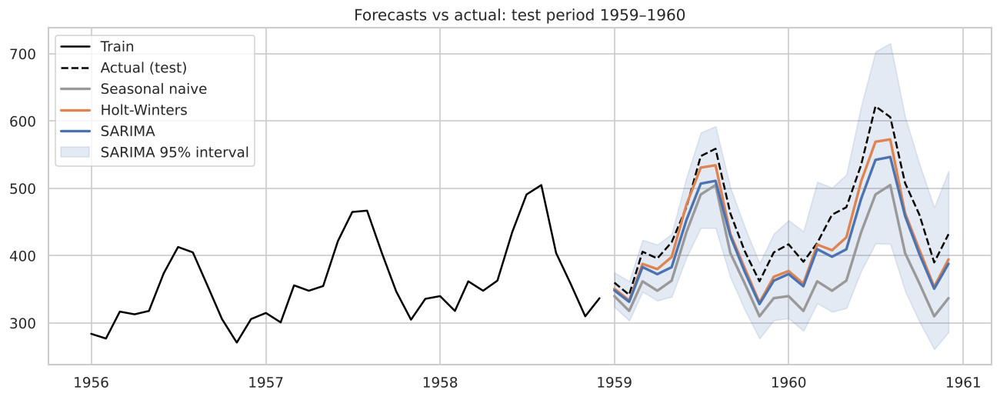
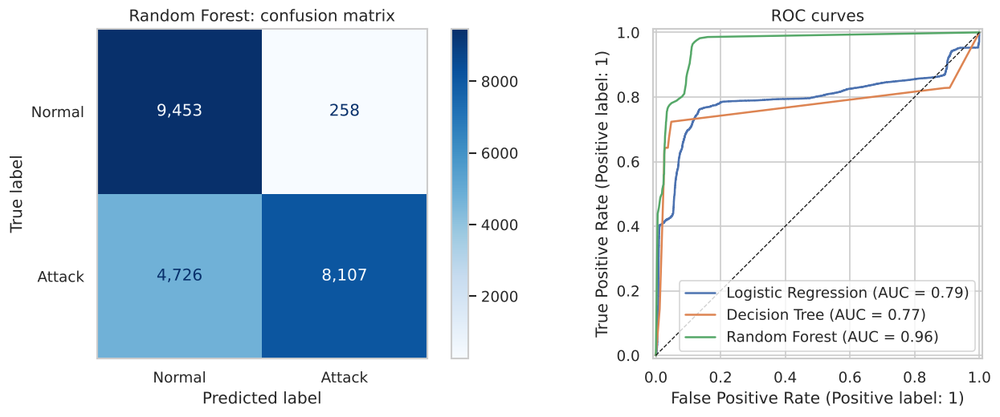

# Umar Farooq: Machine Learning & Data Science Portfolio

🌐 **Website:** https://umar-farooq-amanat.github.io  ·  💼 [LinkedIn](https://www.linkedin.com/in/umarfarooq321)

Data Analytics Master's student specializing in AI & ML, with a background as a full-stack developer (MERN).
This repository hosts my portfolio website and my data science projects.

## 📂 Projects

| Project | Topic | Highlights | Tools |
|---|---|---|---|
| [✈️🏅 Flights & Olympics EDA](projects/flights-olympics-eda) | Exploratory data analysis | 336k NYC flights & 120 years of Olympic history | pandas, Matplotlib, Seaborn |
| [📈 Linear Regression from Scratch](projects/linear-regression) | Machine learning fundamentals | Normal equation + gradient descent in NumPy, R² = 0.79 | NumPy, scikit-learn |
| [📉 Time Series Forecasting](projects/time-series-forecasting) | Forecasting | SARIMA & Holt-Winters, 6.4 % error vs 15.5 % baseline | statsmodels |
| [🛡️ Network Intrusion Detection](projects/intrusion-detection) | ML for cybersecurity | NSL-KDD attack detection, ROC-AUC 0.96 | scikit-learn |

<p align="center">


</p>

## ▶️ Running a project
```bash
cd projects/<project-name>
pip install -r requirements.txt
jupyter notebook
```

## 📁 Repository structure
```
├── index.html                  # portfolio website (GitHub Pages)
├── README.md
└── projects/
    ├── flights-olympics-eda/
    ├── linear-regression/
    ├── time-series-forecasting/
    └── intrusion-detection/
```
