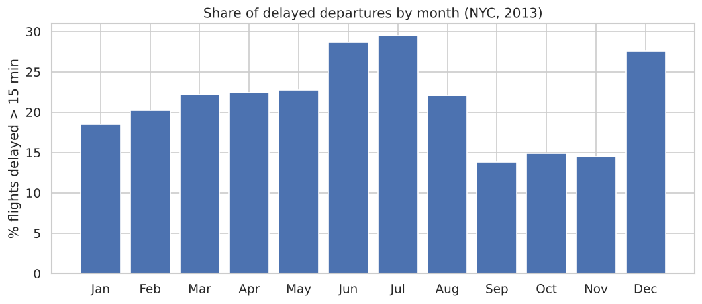
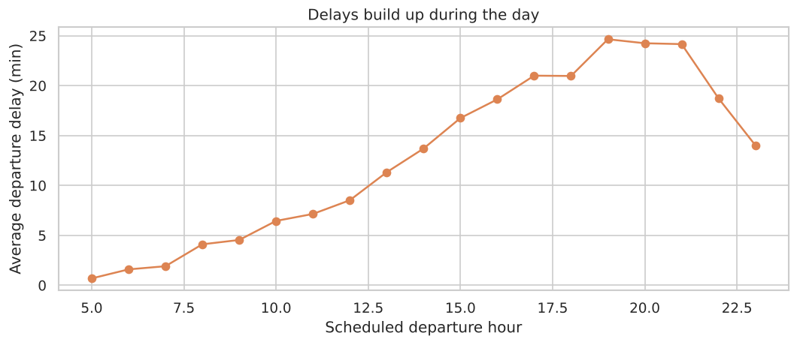
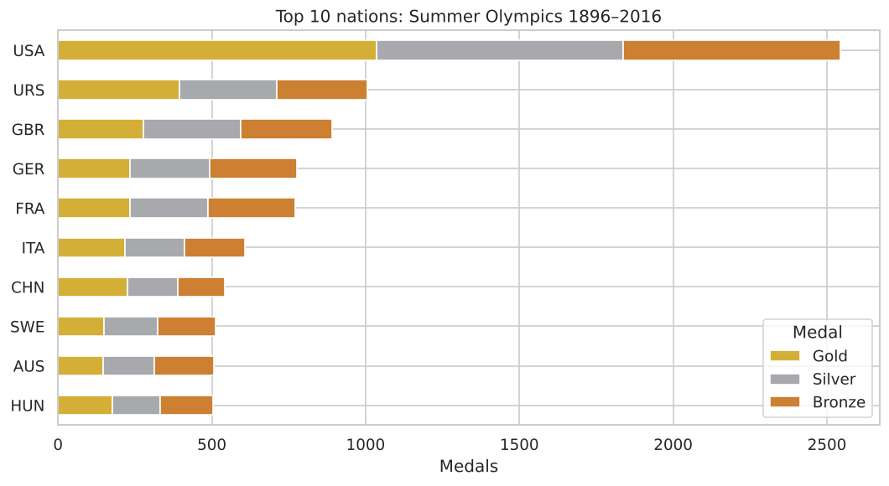
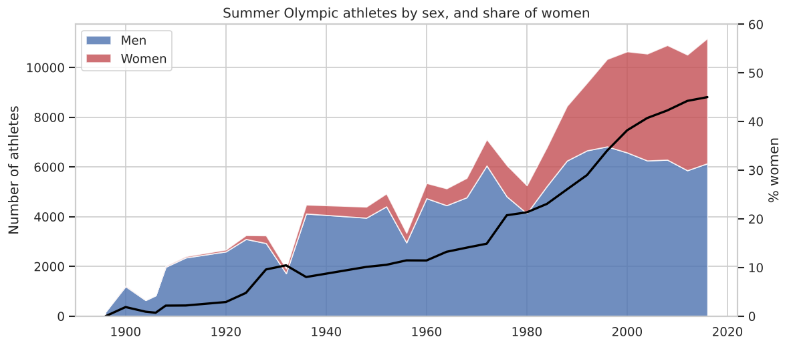

# ✈️🏅 Exploratory Data Analysis: NYC Flights & 120 Years of Olympic History

An end-to-end exploratory data analysis (EDA) of two real-world datasets with **Python, pandas, Matplotlib and Seaborn**.

| Dataset | Size | Question |
|---|---|---|
| NYC Flights 2013 (`nycflights13`) | 336,776 flights | When and why are flights delayed? |
| Olympic History 1896–2016 | 271,116 athlete entries | Who dominates, and how has participation changed? |

## 🔍 Key insights

- **2.5 %** of NYC flights in 2013 were cancelled.
- In **June, July and December ~29 %** of flights left more than 15 minutes late, vs ~14 % in autumn.
- Delays **build up during the day**: early-morning flights are the most punctual.
- Departure delay almost fully predicts arrival delay (**r = 0.92**).
- The **USA** leads the all-time Summer Olympic medal table with 2,544 medals.
- Women went from **< 5 % of athletes (pre-1928) to 45 % (2016)**.

<p align="center"> </p>
<p align="center"> </p>

## 🛠️ Techniques
Missing-value handling · groupby & aggregation · merging tables · avoiding double-counting of team medals · correlation · distribution plots

## ▶️ Run it
```bash
pip install -r requirements.txt
jupyter notebook flights_olympics_eda.ipynb
```
The Olympic data is downloaded automatically from the [rgriff23/Olympic_history](https://github.com/rgriff23/Olympic_history) repository (originally scraped from sports-reference.com).
