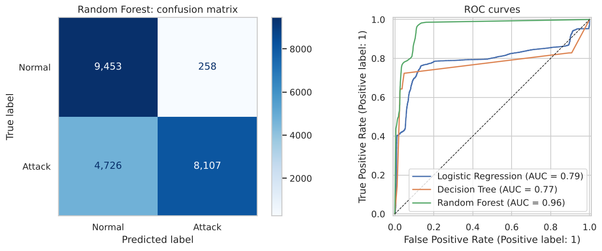
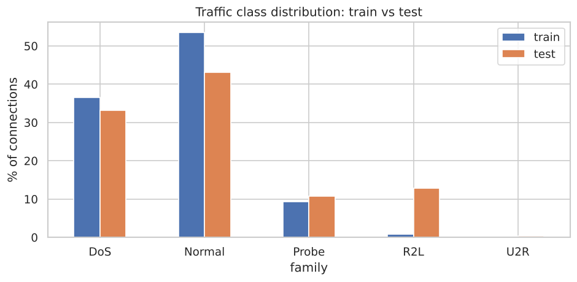
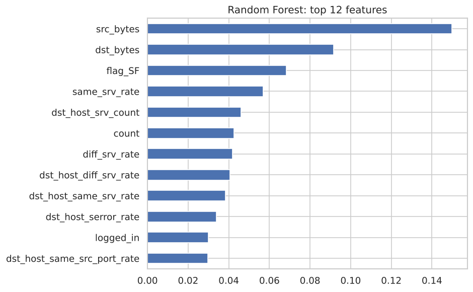

# 🛡️ Machine Learning for Network Intrusion Detection

Detecting malicious network connections with supervised machine learning on the **NSL-KDD** benchmark (125,973 training / 22,544 test connections, 41 features).

The official test set contains **17 attack types never seen in training** (16.6 % of test rows), so it measures how well models generalise to new attacks.

## Workflow
1. Group 39 attack labels into families: **DoS, Probe, R2L, U2R**
2. Explore class distributions and key features
3. Preprocessing with a scikit-learn `Pipeline` (one-hot encoding + scaling, no data leakage)
4. Compare **Logistic Regression, Decision Tree, Random Forest**
5. Error analysis by attack family and for unseen attack types; feature importance

## 📊 Results (binary: attack vs normal)

| Model | Accuracy | Precision | Recall | F1 | ROC-AUC |
|---|---|---|---|---|---|
| Logistic Regression | 0.754 | 0.918 | 0.624 | 0.743 | 0.792 |
| Decision Tree | 0.784 | 0.967 | 0.643 | 0.772 | 0.773 |
| **Random Forest** | 0.779 | **0.969** | 0.632 | 0.765 | **0.962** |

**Key finding:** known attack types are detected **77 %** of the time, but brand-new attack types only **30 %**. R2L attacks are the hardest (6 %). This shows why real intrusion detection systems combine supervised models with **anomaly detection**.

<p align="center"></p>
<p align="center"> </p>

## ▶️ Run it
```bash
pip install -r requirements.txt
jupyter notebook network_intrusion_detection.ipynb
```
Data is downloaded automatically from a public mirror of the [NSL-KDD dataset](https://www.unb.ca/cic/datasets/nsl.html) (Canadian Institute for Cybersecurity).
