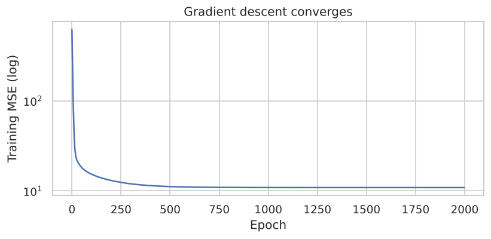
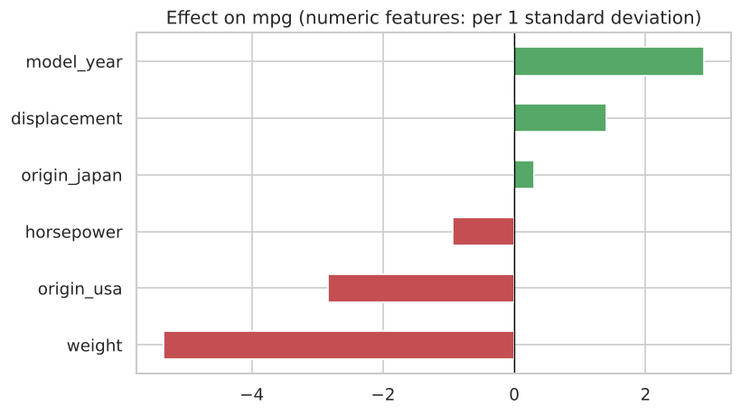
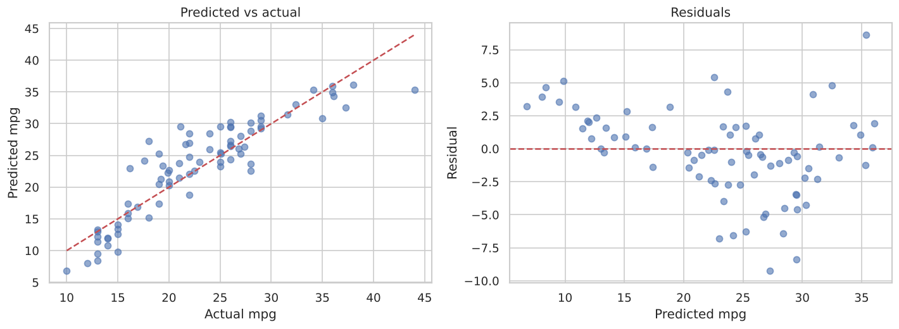

# 📈 Linear Regression from Scratch

Implementing linear regression **from first principles with NumPy**, in two ways, and verifying the results against scikit-learn.
Task: predict a car's **fuel efficiency (mpg)** from weight, horsepower, engine size, model year and origin (UCI Auto MPG dataset).

## What's inside
1. **Normal equation**: closed-form solution β = (XᵀX)⁻¹Xᵀy
2. **Gradient descent**: iterative optimisation of the mean squared error
3. **Verification**: both match `sklearn.LinearRegression` (difference < 10⁻¹³ for the normal equation)
4. **Evaluation metrics written from scratch**: RMSE, MAE, R²
5. **Residual analysis & coefficient interpretation**

## 📊 Results (test set, 79 unseen cars)

| Model | RMSE (mpg) | MAE (mpg) | R² |
|---|---|---|---|
| **Linear regression** | **3.29** | **2.48** | **0.79** |
| Baseline (predict mean) | 7.19 | 5.88 | −0.01 |

<p align="center"> </p>
<p align="center"></p>

**Takeaways:** weight is the strongest negative factor, newer cars are more efficient, and the slightly curved residuals suggest adding non-linear features as a next step.

## ▶️ Run it
```bash
pip install -r requirements.txt
jupyter notebook linear_regression_from_scratch.ipynb
```
