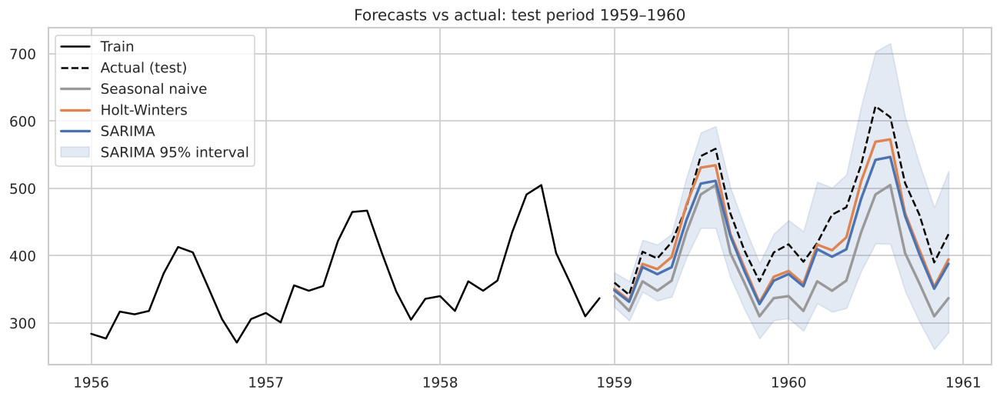
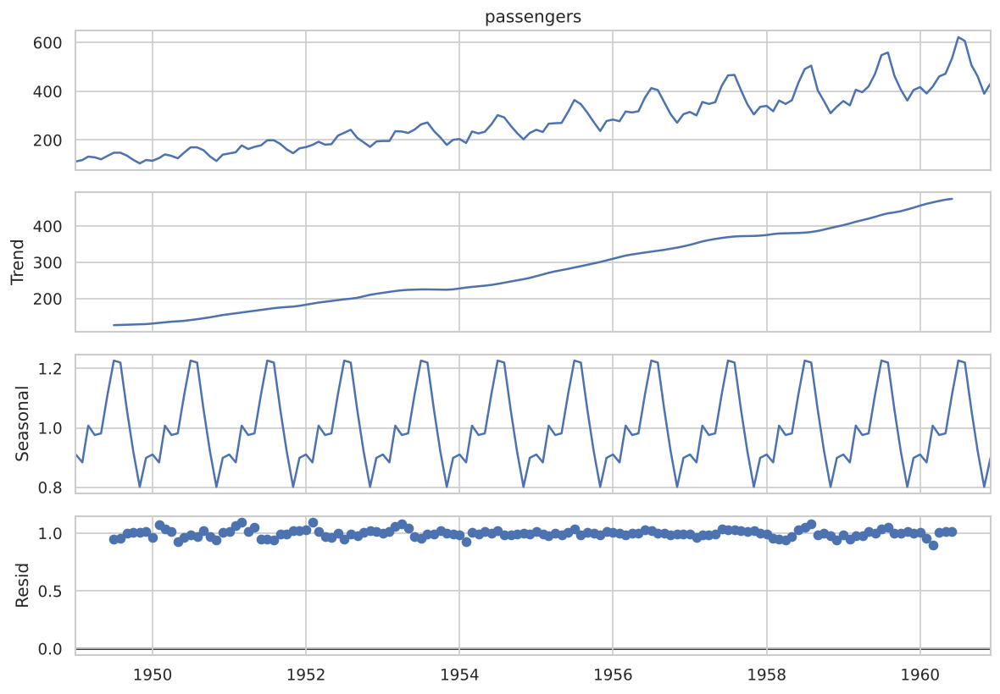
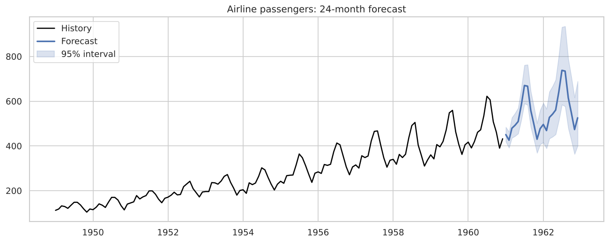

# 📉 Time Series Forecasting: Airline Passengers

Forecasting monthly international airline passengers (1949–1960, Box & Jenkins) with classical time series models, evaluated honestly on a 24-month hold-out period.

## Workflow
1. Visualisation & **multiplicative decomposition** (trend + seasonality)
2. **Stationarity testing** with the Augmented Dickey-Fuller test
3. **ACF / PACF** analysis → model identification
4. Models: Naive, Seasonal naive, **Holt-Winters**, **SARIMA(0,1,1)(0,1,1)₁₂**
5. Out-of-sample evaluation (RMSE, MAPE), residual diagnostics, 2-year forecast

## 📊 Results (test period 1959–1960)

| Model | RMSE | MAPE |
|---|---|---|
| **Holt-Winters** | **32.5** | **6.4 %** |
| SARIMA | 43.2 | 8.5 % |
| Seasonal naive | 77.0 | 15.5 % |
| Naive | 137.3 | 23.6 % |

<p align="center"></p>
<p align="center"> </p>

## ▶️ Run it
```bash
pip install -r requirements.txt
jupyter notebook airline_passenger_forecasting.ipynb
```
